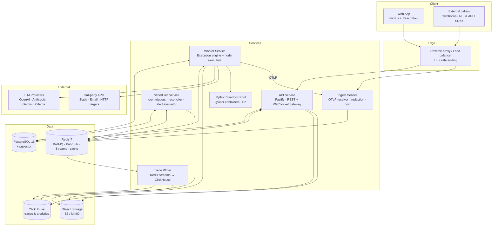
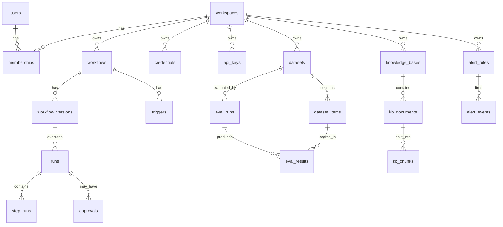

# Architecture

**Product:** AI Workflow Automation & Observability Platform (working title — name TBD)
**Companion docs:** `prd.md` (requirements), `workflow.md` (user journeys and system flows)

---

## 1. Architecture Overview

### 1.1 Principles

1. **PostgreSQL is the source of truth for execution state.** Redis delivers work; it never owns state. Any job can be lost and the system still recovers.
2. **Execution and observability are decoupled.** Tracing is asynchronous and can never fail or slow a run.
3. **Stateless services scale horizontally.** API, workers, and ingest each scale independently.
4. **One node interface.** Every node type is a schema plus an executor implementing the same contract.
5. **Safe by default.** Credentials are decrypted only in workers, code runs in a sandbox, and replays mock side effects.
6. **Measurable.** Every component exports metrics; every claim in the README is backed by a reproducible benchmark.

### 1.2 System Diagram



### 1.3 Services

| Service | Responsibility | Scales by | Runtime |
|---------|----------------|-----------|---------|
| **web** | UI: canvas, run views, trace viewer, dashboards, datasets, evals | CDN / replicas | Next.js (App Router) |
| **api** | REST API, auth, RBAC, workflow CRUD, run creation, webhooks, replay, evals, WebSocket gateway for live updates | CPU / request rate | Node.js + Fastify |
| **worker** | Pulls step jobs from BullMQ, executes nodes, persists state, advances runs, emits spans | Queue depth | Node.js |
| **scheduler** | Cron trigger firing (leader-elected), reconciler loop, alert evaluator, retention jobs | Single active leader + standby | Node.js |
| **ingest** | Receives OTLP spans (internal + external SDKs), validates, redacts PII, computes cost, writes to Redis Streams | Spans/sec | Node.js (Go rewrite optional) |
| **trace-writer** | Consumes Redis Streams in batches, bulk inserts into ClickHouse, offloads large payloads | Stream lag | Node.js (can be co-deployed with ingest) |
| **python-sandbox** *(P2)* | Executes Python code nodes in isolated containers | Pool size | gVisor (`runsc`) containers |

---

## 2. Tech Stack and Rationale

| Layer | Choice | Why |
|-------|--------|-----|
| Language | **TypeScript** (strict) everywhere | One language across UI, API, engine, SDK; shared types |
| Monorepo | **pnpm workspaces + Turborepo** | Fast installs, shared packages, cached builds |
| Frontend | **Next.js, React, Tailwind, shadcn/ui** | Fast UI development; SSR for auth pages |
| Canvas | **React Flow (@xyflow/react)** | Production-grade node editor (pan/zoom, custom nodes, edges) |
| State (client) | **Zustand** (+ TanStack Query for server state) | Simple local graph state; cached server data |
| Code editor | **Monaco Editor** | Code nodes, JSON inputs, prompt editing |
| Charts / tables | **Recharts**, **TanStack Table** | Dashboards, run lists |
| API | **Fastify** + **Zod** validation + OpenAPI generation | Fast, schema-first, typed |
| ORM / migrations | **Drizzle ORM** + drizzle-kit | Type-safe SQL, explicit queries for engine hot paths |
| Execution queue | **BullMQ** on Redis | Delayed jobs, retries, stalled-job detection, rate limiting, mature |
| Primary DB | **PostgreSQL 16** | Transactions and row locks for the state machine; JSONB for graphs/outputs |
| Vector search | **pgvector** | Knowledge-base retrieval without another database |
| Trace store | **ClickHouse** | Columnar, compressed, very fast aggregates over millions of spans |
| Stream buffer | **Redis Streams** | Decouples ingest from ClickHouse writes; consumer groups; backpressure |
| Object storage | **S3** (MinIO locally) | Large payloads, uploaded documents, exports |
| Telemetry | **OpenTelemetry SDK** (OTLP/HTTP) + GenAI semantic conventions | Standard format; external SDK compatibility |
| JS sandbox | **isolated-vm** | Separate V8 isolates with memory and CPU-time limits |
| Python sandbox *(P2)* | **Docker + gVisor** | Kernel-level isolation for untrusted code |
| Auth | **Auth.js** (web) + JWT access tokens for API; workspace API keys | OAuth (GitHub/Google) + email |
| LLM access | Provider SDKs behind an internal **LLM adapter** interface | One interface; easy provider switching; uniform token/cost capture |
| Testing | **Vitest**, **Playwright**, **k6**, **fast-check** | Unit, E2E, load, property-based |
| Platform metrics | **prom-client → Prometheus → Grafana** | Monitor the platform itself |
| Containers / CI | **Docker**, **Docker Compose**, **GitHub Actions**, **Trivy** | Reproducible dev, automated checks |
| Deploy | **AWS** (ECS Fargate or EC2) + RDS + ElastiCache + S3; ClickHouse on EC2 or ClickHouse Cloud | Managed data stores, containerized services |

---

## 3. Repository Structure

```
/
├── apps/
│   ├── web/                    # Next.js frontend
│   │   ├── app/                # routes: (auth), workflows/[id], runs/[id], datasets, evals, dashboards, settings
│   │   ├── components/
│   │   │   ├── canvas/         # React Flow canvas, custom node components, edge types
│   │   │   ├── node-config/    # schema-driven config forms
│   │   │   ├── trace/          # waterfall, span tree, span detail
│   │   │   └── charts/
│   │   └── lib/                # api client, websocket client, stores
│   ├── api/                    # Fastify API + WebSocket gateway
│   │   └── src/{routes,services,auth,ws,plugins}
│   ├── worker/                 # BullMQ consumers → engine
│   ├── scheduler/              # cron triggers, reconciler, alert evaluator, retention
│   └── ingest/                 # OTLP receiver + trace writer
├── packages/
│   ├── engine/                 # graph compiler, state machine, advance(), retry policy, expression resolver
│   ├── nodes/                  # node definitions: schema + executor per node type
│   ├── llm/                    # provider adapters, pricing table, token accounting
│   ├── db/                     # Drizzle schema, migrations, query helpers
│   ├── clickhouse/             # ClickHouse schema, migrations, query builders
│   ├── telemetry/              # OTel setup, span helpers, semantic attribute constants
│   ├── sandbox/                # isolated-vm runner, python sandbox client
│   ├── crypto/                 # envelope encryption for credentials
│   ├── shared/                 # types, zod schemas, constants, error classes
│   ├── sdk-ts/                 # external tracing SDK (P2)
│   └── ui/                     # shared UI primitives
├── sdk-python/                 # external tracing SDK (P2)
├── infra/
│   ├── docker/                 # Dockerfiles
│   ├── compose/                # docker-compose.yml (dev), docker-compose.bench.yml
│   ├── terraform/              # AWS infra (optional)
│   └── grafana/                # dashboards as JSON
├── bench/
│   ├── k6/                     # load scenarios
│   ├── chaos/                  # worker-kill scripts + invariant checker
│   └── ingest/                 # span generator + query benchmarks
├── docs/                       # prd.md, workflow.md, architecture.md, ADRs, benchmark reports
└── .github/workflows/          # CI pipelines
```

---

## 4. Data Model — PostgreSQL

### 4.1 Entity Relationships



### 4.2 Tables (key columns)

```sql
-- Identity & tenancy -------------------------------------------------------
users(id uuid pk, email citext unique, name, password_hash null, avatar_url,
      created_at)

workspaces(id uuid pk, name, slug unique, retention_days int default 30,
           redaction_rules jsonb, created_at)

memberships(workspace_id fk, user_id fk, role text check (role in ('owner','editor','viewer')),
            created_at, primary key (workspace_id, user_id))

api_keys(id uuid pk, workspace_id fk, name, key_prefix text, key_hash text,  -- only hash stored
         scopes text[], last_used_at, expires_at, created_by fk, created_at)

credentials(id uuid pk, workspace_id fk, name, type text,             -- 'openai','anthropic','http_bearer','slack',...
            ciphertext bytea, iv bytea, auth_tag bytea,
            encrypted_dek bytea, key_version int,                     -- envelope encryption
            created_by fk, created_at, updated_at)

-- Workflows -----------------------------------------------------------------
workflows(id uuid pk, workspace_id fk, name, description,
          draft_graph jsonb,                                         -- autosaved draft
          published_version_id fk null, created_by fk, created_at, updated_at)

workflow_versions(id uuid pk, workflow_id fk, version int,
                  graph jsonb not null,                              -- immutable compiled graph
                  status text check (status in ('draft_snapshot','published','archived')),
                  note text, created_by fk, created_at,
                  unique (workflow_id, version))

triggers(id uuid pk, workflow_id fk, type text check (type in ('manual','webhook','schedule','api')),
         webhook_token text unique null, cron text null, timezone text null,
         sync_response bool default false, enabled bool, next_fire_at timestamptz null,
         created_at)

-- Execution -----------------------------------------------------------------
runs(id uuid pk, workspace_id fk, workflow_id fk, version_id fk,
     status text,          -- queued|running|waiting|succeeded|failed|cancelled|timed_out
     mode text,            -- production|test|replay|eval
     trigger_type text, input jsonb, output jsonb null, error jsonb null,
     trace_id char(32),    -- OTel trace id
     parent_run_id fk null, replay_of_step_id fk null, eval_run_id fk null,
     safe_mode bool default false,
     max_duration_ms int, started_at, finished_at, created_at,
     total_cost_usd numeric(12,6) default 0, total_tokens int default 0)
  index (workspace_id, created_at desc), index (workflow_id, status), index (status) where status in ('queued','running','waiting')

step_runs(id uuid pk, run_id fk, node_id text, node_type text,
          iteration int default 0,                                    -- loop iteration
          status text,      -- pending|queued|running|retrying|waiting|succeeded|failed|skipped|cancelled
          attempt int default 0,
          input jsonb null,                                          -- resolved input snapshot
          output jsonb null, output_ref text null,                    -- S3 key if large
          error jsonb null,                                          -- {type, message, retryable, details}
          lease_expires_at timestamptz null,                          -- worker lease
          resume_at timestamptz null,                                 -- for delays
          span_id char(16) null,
          queued_at, started_at, finished_at, duration_ms int,
          cost_usd numeric(12,6) default 0, tokens_in int default 0, tokens_out int default 0,
          unique (run_id, node_id, iteration))
  index (run_id), index (status, lease_expires_at), index (status, resume_at)

approvals(id uuid pk, run_id fk, step_run_id fk, token_hash text unique,
          status text check (status in ('pending','approved','rejected','expired')),
          decided_by fk null, comment text, expires_at, decided_at, created_at)

-- Datasets & evals ---------------------------------------------------------
datasets(id uuid pk, workspace_id fk, name, description, target_workflow_id fk null, created_at)

dataset_items(id uuid pk, dataset_id fk, input jsonb, expected_output jsonb null,
              source_run_id fk null, source_step_id fk null, tags text[], created_at)

eval_runs(id uuid pk, dataset_id fk, target_type text check (target_type in ('workflow_version','node')),
          version_id fk, node_id text null, scorers jsonb,             -- [{type, config}]
          status text, concurrency int,
          aggregate jsonb null,                                       -- {pass_rate, mean_score, cost, p50_latency,...}
          triggered_by text check (triggered_by in ('manual','publish_gate')),
          started_at, finished_at, created_at)

eval_results(id uuid pk, eval_run_id fk, dataset_item_id fk, run_id fk,
             output jsonb, scores jsonb,                              -- [{scorer, score, passed, reasoning}]
             passed bool, cost_usd numeric(12,6), latency_ms int, created_at)

publish_gates(workflow_id fk pk, dataset_id fk, scorers jsonb,
              rule jsonb,          -- {type:'absolute', min_pass_rate:0.9} | {type:'relative', max_drop:0.05}
              enabled bool)

-- Knowledge bases ------------------------------------------------------------
knowledge_bases(id uuid pk, workspace_id fk, name, embedding_model text, dims int, created_at)
kb_documents(id uuid pk, kb_id fk, filename, s3_key, status text, chunk_count int, created_at)
kb_chunks(id uuid pk, document_id fk, kb_id fk, content text, metadata jsonb,
          embedding vector(1536))
  index using hnsw (embedding vector_cosine_ops)

-- Alerts, pricing, audit ----------------------------------------------------
alert_rules(id uuid pk, workspace_id fk, name, workflow_id fk null,
            metric text,           -- error_rate|p95_latency_ms|cost_usd|failed_runs
            operator text, threshold numeric, window_minutes int, cooldown_minutes int,
            channels jsonb,        -- [{type:'slack', webhook_credential_id}, {type:'email', to:[...]}]
            state text default 'ok', enabled bool, created_at)

alert_events(id uuid pk, rule_id fk, status text check (status in ('firing','resolved')),
             value numeric, fired_at, resolved_at, notified jsonb)

model_pricing(provider text, model text, input_per_1m numeric, output_per_1m numeric,
              effective_from date, primary key (provider, model, effective_from))

audit_logs(id bigserial pk, workspace_id fk, actor_id fk, action text,
           target_type text, target_id text, metadata jsonb, created_at)
```

### 4.3 Workflow Graph JSON (stored in `draft_graph` and `workflow_versions.graph`)

```json
{
  "schemaVersion": 1,
  "nodes": [
    { "id": "trigger", "type": "trigger.webhook", "position": {"x": 0, "y": 0}, "config": {} },
    { "id": "classify", "type": "ai.classifier", "position": {"x": 300, "y": 0},
      "config": {
        "credentialId": "cred_123", "model": "gpt-4o-mini",
        "text": "{{trigger.body.message}}",
        "labels": ["billing", "bug", "feature", "other"]
      },
      "settings": { "timeoutMs": 30000, "retry": {"maxAttempts": 3, "backoff": "exponential", "baseDelayMs": 1000}, "continueOnError": false }
    },
    { "id": "route", "type": "logic.switch", "config": { "value": "{{nodes.classify.output.label}}", "cases": ["billing", "bug"] } }
  ],
  "edges": [
    { "id": "e1", "source": "trigger", "target": "classify" },
    { "id": "e2", "source": "classify", "target": "route" },
    { "id": "e3", "source": "route", "sourceHandle": "bug", "target": "extract" }
  ]
}
```

On publish, the graph is **compiled**: topologically sorted, validated, expression references pre-parsed, and adjacency lists stored for fast `advance()` lookups.

---

## 5. Data Model — ClickHouse (Observability)

### 5.1 Spans Table

```sql
CREATE TABLE spans
(
    workspace_id      UUID,
    trace_id          FixedString(32),
    span_id           FixedString(16),
    parent_span_id    FixedString(16),
    run_id            UUID,
    step_run_id       Nullable(UUID),
    workflow_id       UUID,
    version_id        UUID,
    node_id           LowCardinality(String),
    node_type         LowCardinality(String),
    span_kind         LowCardinality(String),   -- run | step | llm | tool | http | eval
    name              String,
    status            LowCardinality(String),   -- ok | error
    start_time        DateTime64(6, 'UTC'),
    end_time          DateTime64(6, 'UTC'),
    duration_ms       Float64,
    attempt           UInt16,
    -- GenAI fields (OTel GenAI semantic conventions mapped to columns)
    gen_ai_system     LowCardinality(String),   -- openai | anthropic | ...
    gen_ai_model      LowCardinality(String),
    input_tokens      UInt32,
    output_tokens     UInt32,
    cost_usd          Float64,
    -- payloads (redacted) — large ones offloaded to S3
    input             String  CODEC(ZSTD(3)),
    output            String  CODEC(ZSTD(3)),
    payload_ref       String,                   -- S3 key when offloaded
    error_type        LowCardinality(String),
    error_message     String,
    attributes        Map(String, String),
    mode              LowCardinality(String),   -- production | test | replay | eval
    INDEX idx_error error_message TYPE tokenbf_v1(8192, 3, 0) GRANULARITY 4,
    INDEX idx_trace trace_id TYPE bloom_filter GRANULARITY 4
)
ENGINE = MergeTree
PARTITION BY toYYYYMM(start_time)
ORDER BY (workspace_id, toStartOfHour(start_time), workflow_id, trace_id, span_id)
TTL toDateTime(start_time) + INTERVAL 30 DAY;      -- per-workspace retention handled by deletion jobs
```

### 5.2 Aggregates (Materialized View)

```sql
CREATE TABLE step_metrics_1m
(
    workspace_id UUID, workflow_id UUID, node_id LowCardinality(String),
    gen_ai_model LowCardinality(String), minute DateTime,
    calls UInt64, errors UInt64,
    duration_quantiles AggregateFunction(quantilesTDigest(0.5, 0.95, 0.99), Float64),
    input_tokens UInt64, output_tokens UInt64, cost_usd Float64
)
ENGINE = AggregatingMergeTree
ORDER BY (workspace_id, workflow_id, minute, node_id, gen_ai_model);

CREATE MATERIALIZED VIEW step_metrics_1m_mv TO step_metrics_1m AS
SELECT workspace_id, workflow_id, node_id, gen_ai_model,
       toStartOfMinute(start_time) AS minute,
       count() AS calls, countIf(status = 'error') AS errors,
       quantilesTDigestState(0.5, 0.95, 0.99)(duration_ms) AS duration_quantiles,
       sum(input_tokens) AS input_tokens, sum(output_tokens) AS output_tokens, sum(cost_usd) AS cost_usd
FROM spans WHERE span_kind IN ('step', 'llm')
GROUP BY workspace_id, workflow_id, node_id, gen_ai_model, minute;
```

A similar `run_metrics_1m` view (from `span_kind = 'run'`) powers run success rate, run latency, and alert evaluation.

### 5.3 Why both PostgreSQL and ClickHouse?

| Concern | PostgreSQL | ClickHouse |
|---------|------------|------------|
| Execution state (needs transactions, row locks) | ✅ | ❌ |
| Small, frequently updated rows | ✅ | ❌ (append-optimized) |
| Millions of immutable spans | Slows down, bloats | ✅ compressed, fast scans |
| Time-series aggregates (p95, cost by day) | Slow at scale | ✅ sub-second |

`step_runs` keeps the **summary** needed for execution and the canvas overlay; ClickHouse keeps the **full detail** (prompts, responses, all attempts, child spans).

---

## 6. Redis Usage

| Purpose | Structure | Key pattern |
|---------|-----------|-------------|
| Step job queue | BullMQ queue | `bull:steps:*` |
| Eval scoring queue | BullMQ queue | `bull:scoring:*` |
| KB ingestion queue | BullMQ queue | `bull:kb-ingest:*` |
| Live run events | Pub/Sub channel | `run:{runId}` |
| Span buffer | Stream + consumer group `writers` | `spans:stream`, `spans:dlq` |
| Run cancellation flags | String with TTL | `cancel:{runId}` |
| Workspace concurrency semaphore | Sorted set (token per active step, scored by expiry) | `sem:ws:{workspaceId}` |
| Provider rate limiting | Token bucket (Lua script) | `rl:cred:{credentialId}` |
| API rate limiting | Sliding window | `rl:api:{apiKeyId}`, `rl:hook:{token}` |
| Scheduler leader election | `SET NX PX` lease | `leader:scheduler` |
| Expression/graph cache | Hash with TTL | `graph:{versionId}` |

**Persistence:** AOF enabled (`appendfsync everysec`). Losing Redis data is survivable because the reconciler rebuilds queues from PostgreSQL state.

---

## 7. Execution Engine Design

### 7.1 Node Interface

```ts
// packages/nodes/src/types.ts
export interface NodeDefinition<TConfig, TInput, TOutput> {
  type: string;                         // 'ai.llm', 'action.http', ...
  category: 'trigger' | 'ai' | 'logic' | 'action' | 'code' | 'data' | 'output';
  displayName: string;
  configSchema: z.ZodType<TConfig>;     // drives the config form + validation
  outputSchema?: z.ZodType<TOutput>;    // used for autocomplete + validation
  sideEffect: boolean;                  // true → mocked in safe mode
  credentialTypes?: string[];
  defaults: { timeoutMs: number; retry: RetryPolicy };
  execute(ctx: ExecContext<TConfig, TInput>): Promise<NodeResult<TOutput>>;
  mock?(ctx: ExecContext<TConfig, TInput>): Promise<NodeResult<TOutput>>; // safe-mode output
}

export interface ExecContext<TConfig, TInput> {
  runId: string; stepId: string; nodeId: string; iteration: number; attempt: number;
  config: TConfig;                      // expressions already resolved
  input: TInput;                        // upstream data
  credentials: CredentialAccessor;      // decrypt on demand, in memory only
  idempotencyKey: string;               // `${runId}:${nodeId}:${iteration}`
  signal: AbortSignal;                  // timeout + cancellation
  tracer: SpanHelper;                   // create child spans (llm/http/tool)
  logger: StepLogger;
  safeMode: boolean;
}

export type NodeResult<T> =
  | { kind: 'success'; output: T; branch?: string | string[] }   // branch for condition/switch
  | { kind: 'wait'; resumeAt?: Date; approvalId?: string }        // delay / approval
  | { kind: 'error'; error: StepError };                          // StepError.retryable decides retry
```

### 7.2 Engine Components

| Component | Responsibility |
|-----------|----------------|
| `compiler` | Validate graph, detect cycles (only allowed inside Loop sub-graphs), topological order, adjacency maps, pre-parse expressions |
| `expression` | Safe template resolver for `{{ }}` (JSONPath-like access + a small whitelisted function set: `json`, `upper`, `lower`, `length`, `default`, `now`); **no `eval`** |
| `state-machine` (`packages/db`) | Defines allowed run and step transitions and persists each with one status-guarded `UPDATE ... RETURNING`. The helpers accept the database connection or an existing transaction. |
| `advance` | Scheduling algorithm (see `workflow.md` B5) — runs inside the step-completion transaction |
| `retry` | Error classification, backoff with jitter, Retry-After support |
| `dispatcher` | Enqueues ready steps after commit; applies workspace concurrency and provider rate limits |
| `reconciler` | Repairs drift between PostgreSQL state and the queue (called by the scheduler) |
| `payloads` | Offloads outputs > 256 KB to S3; transparent load on read |

### 7.3 Concurrency & Correctness

- **Per-run serialization:** `advance()` takes `SELECT ... FOR UPDATE` on the run row, so two parallel branches finishing at the same moment cannot both schedule a merge node.
- **Claiming:** `UPDATE step_runs SET status='running', lease_expires_at=now()+interval '60s' WHERE id=$1 AND status='queued' RETURNING *`. Zero rows means another worker owns it, or it's done.
- **Leases:** workers extend `lease_expires_at` every 20 s for long steps; the reconciler treats an expired lease as a crashed worker.
- **Job IDs:** `runId:nodeId:iteration:attempt` — BullMQ deduplicates identical job IDs, so a double-enqueue is harmless.
- **Outbox-style enqueue:** state is committed first, then jobs are enqueued; the reconciler covers the gap if the process dies in between.
- **Worker concurrency:** each worker process runs N concurrent jobs (default 20; I/O-bound LLM calls); CPU-heavy code nodes run in isolates with their own limits.

### 7.4 LLM Adapter (`packages/llm`)

```ts
interface LLMProvider {
  id: 'openai' | 'anthropic' | 'gemini' | 'ollama' | 'mock';
  chat(req: ChatRequest, opts: { signal: AbortSignal; apiKey?: string }): Promise<ChatResponse>;
  stream?(req: ChatRequest, opts): AsyncIterable<ChatChunk>;
}
// ChatResponse → { content, toolCalls?, usage: {inputTokens, outputTokens}, finishReason, raw }
```

- Normalizes messages, tool calls, structured output (JSON schema), and usage across providers.
- Wraps every call in a `gen_ai` span with `gen_ai.system`, `gen_ai.request.model`, `gen_ai.usage.input_tokens`, `gen_ai.usage.output_tokens`, and finish reasons.
- **Mock provider** returns deterministic outputs with configurable latency/error rates — used for load tests, chaos tests, and CI.

### 7.5 Sandbox

**JavaScript (isolated-vm):**
- A new isolate per execution, with memory limit (default 64 MB) and timeout (default 5 s CPU / 10 s wall).
- Only the `input` (copied as JSON) and a minimal `console` are exposed — no `require`, no network, no filesystem, no host references.
- Output must be JSON-serializable and under the size limit.

**Python *(P2)*:**
- A warm pool of gVisor (`runsc`) containers with no network, a read-only root filesystem, tmpfs scratch space, CPU and memory cgroup limits.
- Code and input are sent over a local socket; the container is recycled after each run.

### 7.6 HTTP Node Safety (SSRF)

- Resolve DNS first, then block private (10/8, 172.16/12, 192.168/16), loopback, link-local (169.254/16, including the cloud metadata endpoint), and IPv6 equivalents.
- Re-check the resolved IP at connect time (defends against DNS rebinding).
- Limits: max response size (10 MB), max redirects (5), timeout.

---

## 8. Observability Design

### 8.1 Span Model

```
workflow.run              (root; attributes: run_id, workflow_id, version_id, mode, trigger_type)
├── workflow.step         (node_id, node_type, attempt, status)
│   └── gen_ai.chat       (gen_ai.system, gen_ai.request.model, usage tokens, cost_usd)
├── workflow.step
│   └── http.client       (http.method, url (redacted query), status_code)
└── workflow.step (agent)
    ├── gen_ai.chat       (iteration 1)
    ├── tool.call         (tool name, args, result)
    └── gen_ai.chat       (iteration 2)
```

- `trace_id` is generated at run creation and stored on `runs`, so the UI can jump from a run directly to its trace.
- Each step span ID is stored on `step_runs.span_id` for the canvas ↔ trace link.

### 8.2 Ingest Service

- **Endpoint:** `POST /v1/traces` (OTLP/HTTP, protobuf or JSON).
- **Auth:** internal service token (workers) or workspace API key (external SDKs).
- **Pipeline:** decode → validate → map OTel attributes to columns → **redact** (workspace rules: email, phone, card-like numbers, custom regex) → **cost** (`model_pricing` lookup, cached) → truncate/offload payloads > 32 KB → `XADD spans:stream`.
- **Backpressure:** if stream length > threshold → return 429 with Retry-After; the OTel SDK retries with backoff.

### 8.3 Trace Writer

- `XREADGROUP` batches (up to 10k entries or 1 s), then a ClickHouse `INSERT` in native format (async insert disabled; we batch ourselves).
- Ack after a successful insert; on failure retry with backoff; after 5 failures → `spans:dlq`.
- Metrics: stream lag, batch size, insert latency, DLQ count.

### 8.4 Query Patterns

| UI feature | Query |
|------------|-------|
| Trace viewer | `SELECT ... FROM spans WHERE workspace_id=? AND trace_id=? ORDER BY start_time` (bloom-filter index on trace_id) |
| Runs explorer | PostgreSQL `runs` (status, cost, duration), plus ClickHouse for error-text search |
| Dashboards | `run_metrics_1m` / `step_metrics_1m` aggregates with `quantilesTDigestMerge` |
| Alerts | Same aggregates over the rule's window |
| Top expensive nodes | `SELECT node_id, sum(cost_usd) ... GROUP BY node_id ORDER BY 2 DESC LIMIT 5` |

---

## 9. API Design

### 9.1 REST Endpoints (v1)

**Auth & workspaces**
```
POST   /api/v1/auth/signup | /login | /logout | /refresh
GET    /api/v1/me
GET    /api/v1/workspaces
POST   /api/v1/workspaces
GET    /api/v1/workspaces/:ws/members
POST   /api/v1/workspaces/:ws/members        (invite)
PATCH  /api/v1/workspaces/:ws/members/:userId (role)
```

**Credentials & API keys**
```
GET    /api/v1/workspaces/:ws/credentials      (metadata only — never values)
POST   /api/v1/workspaces/:ws/credentials
PATCH  /api/v1/credentials/:id
DELETE /api/v1/credentials/:id
POST   /api/v1/workspaces/:ws/api-keys          (returns the key once)
DELETE /api/v1/api-keys/:id
```

**Workflows & versions**
```
GET    /api/v1/workspaces/:ws/workflows
POST   /api/v1/workspaces/:ws/workflows
GET    /api/v1/workflows/:id
PATCH  /api/v1/workflows/:id                    (name, draft_graph — autosave)
DELETE /api/v1/workflows/:id
POST   /api/v1/workflows/:id/validate
POST   /api/v1/workflows/:id/publish             (runs publish gate if enabled)
GET    /api/v1/workflows/:id/versions
GET    /api/v1/versions/:versionId
GET    /api/v1/versions/:a/diff/:b
POST   /api/v1/versions/:versionId/restore       (copy into draft)
GET    /api/v1/nodes                              (node catalog: types + schemas)
```

**Triggers & runs**
```
POST   /api/v1/workflows/:id/triggers
PATCH  /api/v1/triggers/:id
POST   /api/v1/workflows/:id/runs                 { input, versionId?, mode? }  → 202 { runId }
POST   /api/v1/workflows/:id/test-runs            { input, draftGraph }        → 202 { runId }
GET    /api/v1/workspaces/:ws/runs                ?workflowId&status&from&to&minCost&q&cursor
GET    /api/v1/runs/:runId                         (run + step summaries)
GET    /api/v1/runs/:runId/steps/:stepId           (input, output, error)
POST   /api/v1/runs/:runId/cancel
POST   /api/v1/runs/:runId/rerun                   { versionId? }
POST   /hooks/:webhookToken                        (public webhook endpoint)
POST   /api/v1/approvals/:token                    { decision: 'approve'|'reject', comment }
```

**Observability**
```
GET    /api/v1/runs/:runId/trace                   (all spans)
GET    /api/v1/workspaces/:ws/metrics              ?metric&groupBy&from&to&workflowId
GET    /api/v1/workspaces/:ws/alert-rules  |  POST  |  PATCH /alert-rules/:id  |  DELETE
GET    /api/v1/workspaces/:ws/alert-events
POST   /v1/traces                                   (ingest service — OTLP)
```

**Debug & improve**
```
POST   /api/v1/steps/:stepId/replay                { configOverrides, safeMode }
POST   /api/v1/runs/:runId/replay-from/:nodeId     { configOverrides, safeMode }
GET    /api/v1/runs/compare?a=&b=
GET    /api/v1/workspaces/:ws/datasets  |  POST
GET    /api/v1/datasets/:id  |  PATCH  |  DELETE
POST   /api/v1/datasets/:id/items                   (add / bulk import)
POST   /api/v1/datasets/:id/items/from-runs         { runIds | stepIds, markExpected }
POST   /api/v1/datasets/:id/evals                   { target, scorers, concurrency }
GET    /api/v1/evals/:evalRunId                     (aggregate + results, paginated)
GET    /api/v1/evals/compare?a=&b=
PUT    /api/v1/workflows/:id/publish-gate
```

**Knowledge bases**
```
POST   /api/v1/workspaces/:ws/knowledge-bases
POST   /api/v1/knowledge-bases/:id/documents        (multipart upload → kb-ingest queue)
GET    /api/v1/knowledge-bases/:id/documents
```

**Conventions:** cursor pagination; Zod-validated bodies; RFC 7807 problem+json errors; `Idempotency-Key` header supported on run creation; OpenAPI spec generated at `/api/v1/openapi.json`.

### 9.2 WebSocket Protocol

```
Client → { "type": "subscribe",   "runId": "..." }
Client → { "type": "unsubscribe", "runId": "..." }
Server → { "type": "step.updated", "runId", "stepId", "nodeId", "iteration", "status", "attempt", "durationMs", "outputPreview" }
Server → { "type": "run.updated",  "runId", "status", "finishedAt", "totalCostUsd" }
Server → { "type": "log",          "runId", "stepId", "level", "message", "ts" }
```

- The gateway authenticates the socket with a JWT and checks workspace access per subscription.
- Fan-out: each API instance subscribes to Redis `run:{runId}` channels only for runs its clients watch.

---

## 10. Security Architecture

| Area | Design |
|------|--------|
| **Authentication** | Auth.js sessions in web; short-lived JWT (15 min) + refresh token (rotating, httpOnly cookie) for API; workspace API keys (prefix + SHA-256 hash stored) |
| **Authorization** | Every query scoped by `workspace_id`; role checks in a Fastify preHandler (owner/editor/viewer matrix) |
| **Credential encryption** | Envelope encryption: random 256-bit DEK per credential → AES-256-GCM encrypt value → DEK encrypted with master key (KMS in prod, env key locally); `key_version` enables rotation; values never returned by the API; decrypted only in worker memory |
| **Secrets in traces** | Credential values never enter node inputs/outputs; HTTP auth headers are stripped from spans; redaction rules applied at ingest |
| **Sandboxing** | isolated-vm (JS), gVisor containers (Python, P2) |
| **SSRF** | IP range blocking + connect-time verification (section 7.6) |
| **Webhooks** | Unguessable tokens (128-bit); optional HMAC signature verification; per-token rate limit |
| **Approvals** | Signed single-use tokens (hash stored), expiry |
| **Transport** | TLS everywhere; HSTS; secure cookies |
| **Input validation** | Zod on every endpoint; size limits on bodies (1 MB default, uploads separate) |
| **Supply chain** | Lockfile, Renovate/Dependabot, osv-scanner, Trivy image scan in CI |
| **Audit** | `audit_logs` for credential, member, publish, gate, and API key changes |

---

## 11. Scalability & Performance

| Component | Bottleneck | Strategy |
|-----------|------------|----------|
| API | Request CPU | Horizontal replicas behind the load balancer; stateless |
| Workers | Concurrent I/O | Horizontal; scale on BullMQ waiting count; per-process concurrency tuning |
| PostgreSQL | Write-heavy `step_runs` updates | Narrow hot-path updates, proper indexes, connection pooling (PgBouncer), partial indexes on active statuses; partition `step_runs` by month if needed |
| Redis | Single-thread ops | Small payloads only (IDs, not data); separate Redis for queues vs streams if needed |
| Ingest | Spans/sec | Horizontal; stateless; Redis Streams buffer |
| ClickHouse | Insert rate | Large batches (≥ 10k rows), ORDER BY tuned for workspace + time queries |
| Live updates | Fan-out | Per-run channels; clients only subscribe to visible runs |

**Hot-path rules:**
- Workers load compiled graphs from a cache (`graph:{versionId}`), not the DB, on every step.
- Upstream outputs are fetched in one query per step (`WHERE run_id = ? AND node_id = ANY(?)`).
- Large outputs are offloaded to S3 so `step_runs` rows stay small.

---

## 12. Monitoring the Platform Itself

**Metrics (prom-client, scraped by Prometheus):**
- `engine_steps_total{status,node_type}`, `engine_step_duration_seconds` (histogram)
- `engine_scheduling_latency_seconds` (completion → next step enqueued)
- `queue_waiting_jobs`, `queue_active_jobs`, `queue_stalled_total`
- `reconciler_repairs_total{kind}` (re-enqueued, lease-expired, timed-out)
- `ingest_spans_received_total`, `ingest_spans_dropped_total`, `stream_lag`, `clickhouse_insert_duration_seconds`
- `http_request_duration_seconds{route,status}`
- `llm_requests_total{provider,model,status}`, `llm_tokens_total`

**Dashboards (Grafana JSON in `infra/grafana`):** Engine health, Queue health, Ingestion pipeline, API latency.
**Logs:** structured JSON (pino) with `run_id`, `step_id`, `trace_id` for correlation.
**Platform alerts:** queue waiting > threshold for 5 min, stream lag > 60 s, reconciler repairs spike, API 5xx rate > 1%.

---

## 13. Deployment

### 13.1 Local (Docker Compose)

```yaml
services:
  postgres:     image: pgvector/pgvector:pg16
  redis:        image: redis:7  (appendonly yes)
  clickhouse:   image: clickhouse/clickhouse-server:24
  minio:        image: minio/minio
  api:          build: infra/docker/api.Dockerfile       ports: 4000
  worker:       build: infra/docker/worker.Dockerfile    deploy.replicas: 2
  scheduler:    build: infra/docker/scheduler.Dockerfile
  ingest:       build: infra/docker/ingest.Dockerfile    ports: 4318
  web:          build: infra/docker/web.Dockerfile       ports: 3000
  prometheus / grafana:  (optional profile "monitoring")
```

`pnpm dev` runs the apps natively with hot reload against the Compose data services. `pnpm db:migrate`, `pnpm ch:migrate`, and `pnpm seed` (demo workspace, templates, mock LLM credential) set up data.

### 13.2 Production (AWS reference)

```
Route 53 → CloudFront (web static) → ALB
ALB → ECS Fargate services: web, api, ingest
ECS Fargate services (no public ingress): worker (autoscaled on queue depth via a CloudWatch custom metric), scheduler (1 task + leader lock)
RDS PostgreSQL (Multi-AZ optional) + pgvector
ElastiCache Redis (AOF)
ClickHouse: EC2 (single node to start) or ClickHouse Cloud
S3: payloads, documents
KMS: master key for credential encryption
Secrets Manager: DB/Redis/ClickHouse credentials
```

Infrastructure as code in `infra/terraform` (optional). Low-cost alternative for a demo: a single VPS running the Compose stack behind Caddy (automatic TLS).

### 13.3 Configuration (environment variables)

```
DATABASE_URL, REDIS_URL, CLICKHOUSE_URL, CLICKHOUSE_USER, CLICKHOUSE_PASSWORD
S3_ENDPOINT, S3_BUCKET, S3_ACCESS_KEY, S3_SECRET_KEY
MASTER_KEY (local) | KMS_KEY_ID (prod)
JWT_SECRET, AUTH_GITHUB_ID/SECRET, AUTH_GOOGLE_ID/SECRET
INGEST_INTERNAL_TOKEN, OTEL_EXPORTER_OTLP_ENDPOINT
WORKER_CONCURRENCY=20, STEP_LEASE_SECONDS=60, RECONCILER_INTERVAL_SECONDS=30
PAYLOAD_OFFLOAD_BYTES=262144, SPAN_PAYLOAD_OFFLOAD_BYTES=32768
DEFAULT_RETENTION_DAYS=30
```

---

## 14. Failure Modes

| Failure | Effect | Handling |
|---------|--------|----------|
| Worker crashes mid-step | Step stuck `running` | Lease expires → reconciler re-queues; BullMQ stalled detection; completed steps never re-run |
| Process dies after commit, before enqueue | Step `queued` with no job | Reconciler re-enqueues after 60 s |
| Redis data loss | Queues empty | Reconciler rebuilds from PostgreSQL (`queued`, expired `running`, due `waiting`) |
| PostgreSQL unavailable | No state transitions | Workers pause claiming (health check), jobs retry; API returns 503 |
| LLM provider 429/5xx | Step errors | Retry with backoff + Retry-After; provider rate limiter prevents bursts |
| LLM provider down for a long time | Many failed steps | Retries exhausted → step failed → alert fires; (P2) fallback provider per node |
| Ingest service down | Spans not received | OTel SDK buffers and retries; runs unaffected; dropped-span counter |
| ClickHouse down | Inserts fail | Spans stay in Redis Stream (bounded); writer retries; DLQ after repeated failure |
| Duplicate webhook delivery | Duplicate runs | Optional `Idempotency-Key` / dedup window per trigger |
| Malicious code node | Escape / resource abuse | Isolate memory/time limits, no host access; container isolation for Python |
| Huge node output | DB bloat, slow UI | Offload > 256 KB to S3; UI shows a preview and lazy-loads |

---

## 15. Key Architecture Decisions (ADR summary)

| # | Decision | Alternatives considered | Reason |
|---|----------|-------------------------|--------|
| ADR-1 | PostgreSQL as source of truth for execution state; Redis/BullMQ only for delivery | Redis-only state; Temporal | Transactions + row locks make correctness provable; building the engine ourselves is the core learning and interview value |
| ADR-2 | Build the execution engine in TypeScript first | Go from day one | Faster to ship with one language; the engine is isolated in `packages/engine`, so the scheduler core can be rewritten in Go later |
| ADR-3 | ClickHouse for traces | PostgreSQL + TimescaleDB, Elasticsearch | Best compression and aggregate speed for append-only spans; used by modern observability tools |
| ADR-4 | OpenTelemetry as the trace format | Custom JSON format | Industry standard; external SDK compatibility; GenAI semantic conventions |
| ADR-5 | Redis Streams between ingest and ClickHouse | Kafka, direct inserts | Already running Redis; enough for target throughput; Kafka adds ops weight (can swap later) |
| ADR-6 | isolated-vm for JS code nodes | Node `vm` module, Deno subprocess, containers | Real V8 isolation with memory limits at low latency; Node `vm` is not a security boundary |
| ADR-7 | Safe-mode replay mocks side effects by default | Always real execution | Prevents debugging from sending real emails or charging cards |
| ADR-8 | DAG with explicit Loop nodes (no arbitrary cycles) | General graphs with cycles | Keeps scheduling, termination, and UI comprehensible |
| ADR-9 | At-least-once execution, exactly-once state transitions, plus idempotency keys | Claiming exactly-once side effects | Exactly-once side effects across external APIs is not achievable in general; being explicit is more honest and more robust |

---

## 16. Benchmark & Chaos Harness

**Load (k6, `bench/k6`):**
- `runs_burst.js`: create 1,000 runs/min of a 10-node workflow with the mock LLM (200 ms latency) → measure end-to-end run latency, scheduling overhead, steps/sec.
- `webhook_spike.js`: 0 → 500 RPS spike on a webhook → API latency, queue growth, drain time.

**Chaos (`bench/chaos`):**
- Start 10,000 runs; every 5–15 s kill a random worker container (`docker kill`); restart it.
- **Invariant checker** (SQL) after completion:
  - every run is terminal
  - no `(run_id, node_id, iteration)` reached `succeeded` more than once (verified via `attempt` counts and the mock executor's per-key invocation counter in Redis)
  - every succeeded run has all reachable nodes terminal
  - executor invocation count for side-effect mock nodes ≤ attempts recorded
- Report: lost steps, duplicate completions, p50/p95 recovery time.

**Ingestion (`bench/ingest`):**
- Synthetic OTLP generator → measure sustained spans/sec at the ingest service and trace-writer lag.
- Load 10M / 50M spans → measure trace fetch and dashboard query latency.

All results are written to `docs/benchmarks/*.md` with hardware specs and commands to reproduce them.
