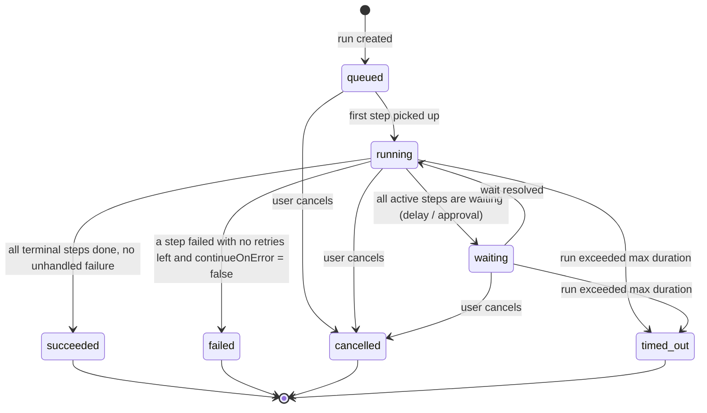
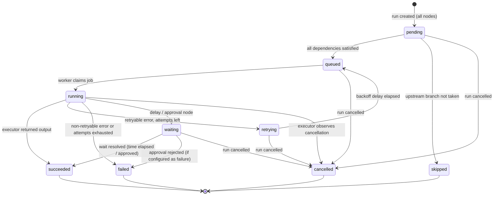
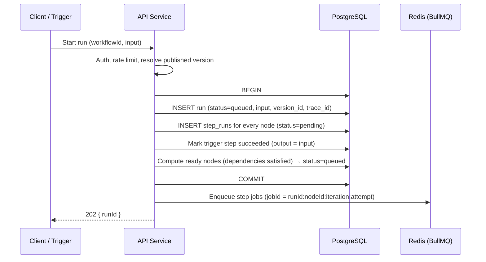
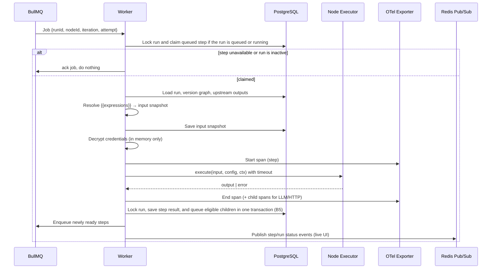
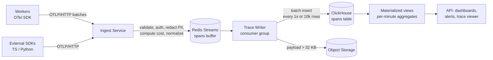
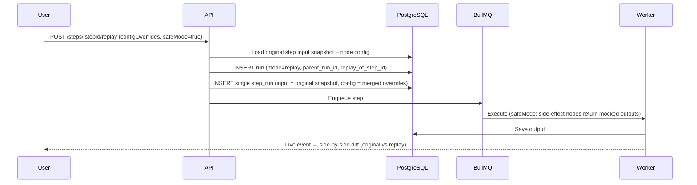

# Workflows — User Journeys & System Flows

**Product:** AI Workflow Automation & Observability Platform (working title — name TBD)
**Companion docs:** `prd.md` (what and why), `architecture.md` (how it's built)

This document describes **how things flow**: what users do step by step, and what the system does internally — run and step lifecycles, the scheduling algorithm, retries and crash recovery, waits, tracing, alerts, replay, evals, and the development workflow.

---

## Part A — User Journeys

### A1. Onboarding

```
Sign up (email / GitHub / Google)
  → Default workspace created (user = Owner)
  → Onboarding screen: "Start from template" or "Blank workflow"
  → Prompted to add first credential (e.g., OpenAI API key) — or use the built-in demo mock model
  → Lands on canvas with the template loaded
```

**Goal:** first successful run in < 5 minutes.

### A2. Build a Workflow

1. User opens the canvas (blank or template).
2. Drags a **Trigger** node (Manual / Webhook / Schedule) onto the canvas.
3. Drags further nodes from the library (LLM, Condition, HTTP, …) and connects them with edges.
4. Clicks a node → the **config panel** opens (form generated from the node's schema).
5. Fills fields; uses `{{ }}` expressions with autocomplete to reference upstream outputs, e.g. `{{nodes.classify.output.label}}`, `{{trigger.body.email}}`.
6. Selects a credential for nodes that need one (LLM, HTTP with auth, Slack, Email).
7. **Autosave** writes the draft every few seconds (debounced).
8. **Validation** runs continuously; problems appear as red badges on nodes:
   - required field empty
   - reference to a node that isn't upstream
   - credential missing
   - illegal cycle (cycles only allowed through Loop nodes)
   - disconnected node

### A3. Test Run from the Editor

1. User clicks **Test run** and enters sample JSON input (or uses pinned/sample data).
2. A run is created against the **current draft** (as a temporary draft version) with `mode = test`.
3. Canvas switches to **live view**: each node shows `queued → running → succeeded / failed / skipped`, with duration.
4. Clicking a node shows its input, output, logs, and (for LLM nodes) prompt, response, tokens, and cost.
5. On failure: the failed node is highlighted and its error panel opens automatically.
6. User fixes the config and clicks **Test run** again, or **Replay step** (see A7).

### A4. Publish

1. User clicks **Publish**, adds an optional version note.
2. System validates the graph (strict mode: all errors are blocking).
3. If a **publish gate** is enabled (see A9):
   - an eval runs against the gate dataset
   - publish is blocked if the score is below the threshold, with a link to the eval report
4. On success: an immutable `workflow_version` is created and marked `published`; triggers now point to it.
5. Previous published version stays in history (restorable).

### A5. Trigger Runs in Production

| Trigger | How a run starts |
|---------|------------------|
| Manual | "Run" button or `POST /api/v1/workflows/:id/runs` |
| Webhook | `POST /hooks/:webhookToken` → async: returns `202 { runId }`; sync mode waits up to N seconds for a "Respond to Webhook" node |
| Schedule | The scheduler service fires cron triggers (timezone-aware) |
| API | `POST /api/v1/workflows/:id/runs` with a workspace API key |

### A6. Monitor

1. **Runs explorer:** filter by workflow, version, status, trigger, date, duration, cost, error text.
2. **Dashboards:** success rate, run volume, p50/p95/p99 latency, cost per day / workflow / model, token usage, top failing nodes, slowest nodes.
3. **Alerts:** user creates a rule, e.g. *"error rate > 10% over 15 min for workflow X → Slack #alerts"*.

### A7. Debug a Failed Run (the core loop)

```
Alert in Slack / failed run in the explorer
  → Open run → trace waterfall + canvas overlay; failed step highlighted
  → Click failed step → see error, input snapshot, config, prompt, raw response
  → Diagnose (e.g., the LLM returned invalid JSON)
  → Click "Replay step"
       → edit prompt / config in the replay panel
       → safe mode ON by default (side-effect nodes mocked)
       → replay executes the single step with the ORIGINAL input snapshot
  → Compare: original output vs replay output, side by side
  → Satisfied → "Apply change to draft"
  → Optional: "Replay from here" → re-runs downstream steps from this point
  → Save failing input to a dataset as a regression case
  → Run eval → publish new version
```

**Target:** under 60 seconds from opening the failed run to a successful replay.

### A8. Build a Dataset

Three ways:

1. **From runs:** select runs/steps in the explorer → "Add to dataset" → stores input + actual output; optionally mark the output as expected.
2. **Import:** upload CSV/JSON; map columns to `input` and `expected_output`.
3. **Manual:** add items in the dataset editor.

### A9. Evaluate and Gate

1. User opens a dataset → **New eval**.
2. Picks a target: a workflow version (full run per item) or a single node (node-level eval).
3. Picks scorers: exact match, contains, regex, JSON-schema valid, numeric threshold, LLM-as-judge (rubric prompt + judge model).
4. Eval runs (items processed in parallel with a concurrency limit; side effects mocked).
5. **Eval report:** per-item output and scores, aggregate score, pass rate, total cost, latency.
6. **Compare:** pick two eval runs (e.g., v3 vs v4) → side-by-side aggregates plus per-item diffs (improved / regressed / unchanged).
7. **Publish gate config:** dataset, scorer set, rule (`pass_rate >= 0.9` or `score_drop <= 5%` vs current published).

### A10. Respond to an Alert

```
Alert fires → Slack message: rule name, current value vs threshold, window,
              link to the filtered runs list
  → User opens failing runs → A7 debug loop
  → Metric recovers → alert auto-resolves → "resolved" message posted
```

---

## Part B — System Flows

### B1. Run Lifecycle (state machine)



**Run statuses:** `queued`, `running`, `waiting`, `succeeded`, `failed`, `cancelled`, `timed_out`.

### B2. Step Lifecycle (state machine)



**Step statuses:** `pending`, `queued`, `running`, `retrying`, `waiting`, `succeeded`, `failed`, `skipped`, `cancelled`.

**Rule:** every state transition is a single conditional `UPDATE ... WHERE status = <expected>` in PostgreSQL. If the expected status doesn't match, the transition is rejected. This prevents double-processing.

`transitionRun` and `transitionStep` in `packages/db` reject invalid state changes and return the updated row when the expected state matches. A stale update or a missing row returns `undefined`. Status, timestamps, and supplied result fields are saved together. The worker uses these helpers to claim a step and start its run in the same transaction as the graph load.

### B3. Run Creation Flow



A trigger-only workflow finishes as `succeeded` in this transaction. It produces no step jobs.

> If enqueuing fails after COMMIT, the **reconciler** (B7) finds `queued` steps with no job and enqueues them. Postgres is the source of truth; Redis is only the delivery mechanism.

### B4. Step Execution Flow (worker)



### B5. Scheduling Algorithm ("advance")

`advance()` locks the run before saving a result and checking children in the same iteration. PostgreSQL stores the selected branch in `step_runs.branch` alongside the step output. When a result names a branch, only edges with that `sourceHandle` or without a handle stay active. The stored choice lets later completions recheck a child with multiple parents.

- **Merge `all` (default) and ordinary nodes** queue when at least one active input is satisfied and every other input is satisfied or skipped.
- **Merge `any`** queues as soon as any active input is satisfied. Later completions leave an already queued merge alone.
- A pending node is skipped when every input comes from an untaken edge or a skipped parent. This check continues through downstream nodes in the same transaction.

The worker publishes ready jobs after commit. If publishing fails, the steps stay queued in PostgreSQL for the planned reconciler (B7).

```text
function advance(runId, completedNodeId):
    lock run row (SELECT ... FOR UPDATE)            // serialize advances per run
    save the step result if the step is still running
    if the result was stale or the run is inactive: return []
    if any step failed without continueOnError:
        mark run failed and cancel pending, queued, retrying, and waiting steps
        return []

    affected = children of completedNodeId
    for child in affected, in topological order:
        if child.status != pending: continue
        inputs = parent states with untaken edges treated as skipped
        if every input is skipped:
            mark child skipped and add its children to the affected set
        elif at least one input is satisfied and (mode is any or every input is satisfied or skipped):
            mark child queued and collect its job

    if every step in every iteration is terminal:
        mark run succeeded and record finished_at

    return stepsToEnqueue    // enqueued AFTER commit
```

**Failure handling:**
- `continueOnError` defaults to `false`. An unhandled failure records the run's finish time and cancels its pending, queued, retrying, and waiting steps. In-flight steps can still save their results. The run stays closed to further scheduling.
- A successful step satisfies its selected outgoing edges. A failure with `continueOnError = true` stays `failed`, stores `{ error }` as its output, and satisfies its outgoing edges. This lets downstream steps read the error while the run continues.

### B6. Retry Flow

```text
on executor error:
    classify error:
        retryable     = network errors, timeouts, HTTP 408/425/429/5xx, provider overload
        non-retryable = validation errors, HTTP 4xx (except above), auth errors, sandbox errors
    if retryable and attempt < node.retry.maxAttempts:
        delay = backoff(type, baseDelay, attempt) + jitter     // exponential: base * 2^attempt, capped
        if 429 with Retry-After header: delay = max(delay, retryAfter)
        UPDATE step SET status=retrying, attempt=attempt+1, last_error=...
        enqueue job with delay (jobId uses the new attempt number)
        retrying → queued when the job becomes active
    else:
        UPDATE step SET status=failed, error=...
        advance(run)
```

Every attempt is recorded as its own span (`attempt` attribute), so the trace shows all retries.

### B7. Crash Recovery

Three layers:

1. **BullMQ stalled-job detection:** each worker holds a lock on its active job and renews it periodically. If the worker dies, the lock expires and BullMQ moves the job back to waiting → another worker picks it up.
2. **Claim check:** the new worker tries `UPDATE step SET status=running WHERE status IN (queued, running) AND lease_expires_at < now()`. Steps already `succeeded` are never re-run (the claim fails and the job is acked).
3. **Reconciler (scheduler service, every 30 s):**
   - finds steps `queued` for > 60 s with no BullMQ job → re-enqueues them
   - finds steps `running` with an expired `lease_expires_at` → resets them to `queued` and re-enqueues
   - finds `waiting` delay steps whose `resume_at` < now and that have no job → enqueues them
   - finds runs past `max_duration` → `timed_out`, cancels open steps

**Side-effect safety:** a crash *after* an external call but *before* the DB commit can cause a re-execution. Mitigation: side-effect nodes send an idempotency key (`runId:nodeId:iteration`) to APIs that support it (Stripe-style `Idempotency-Key` header, email providers), and expose an "idempotency key" field so users can pass it in custom HTTP calls. Documented as **at-least-once execution, exactly-once state**.

### B8. Durable Waits

**Delay node:**
```
step → waiting, resume_at = now + duration
enqueue delayed BullMQ job (delay = duration)  — worker is freed
job fires → step succeeded → advance()
(reconciler covers lost delayed jobs using resume_at)
```

**Human Approval node:**
```
step → waiting; approval record created with a signed token
notify via UI inbox + optional email/Slack with Approve / Reject links
POST /api/v1/approvals/:token { decision, comment }
  → approved: step succeeded (output = { approved: true, by, comment })
  → rejected: step succeeded with { approved: false } or failed (configurable)
  → advance()
optional timeout: reconciler marks expired approvals per config (fail / auto-approve / auto-reject)
```

### B9. Loops (For Each)

```
Loop node receives array input (N items)
  → creates N iterations of its sub-graph: step_runs keyed by (node_id, iteration)
  → enqueues the first nodes of up to `concurrency` iterations
  → when an iteration finishes, the next iteration starts
  → when all N finish: loop step succeeded, output = array of iteration outputs (ordered)
  → item failure behaviour: fail loop | skip item | collect errors (configurable)
```

### B10. Cancellation

```
POST /runs/:id/cancel
  → run.status = cancelled (if not terminal)
  → pending / queued / waiting steps → cancelled
  → running steps: a cancellation flag is set in Redis; executors check it (LLM streaming aborts via AbortController);
                   when they finish, their results are saved, but advance() schedules nothing
  → event published to UI
```

### B11. Live UI Updates

```
Worker commits a state change
  → publishes { runId, stepId, nodeId, status, durationMs, outputPreview } to Redis channel run:{runId}
  → API WebSocket gateway is subscribed for runs that clients are watching
  → pushes to browser → canvas node badge and timeline update
On (re)connect, the client fetches the full run state over REST, then applies live events (no missed updates).
```

### B12. Tracing & Ingestion Pipeline



**Steps:**
1. Workers create spans with the OpenTelemetry SDK:
   - `workflow.run` (root span = the run)
   - `workflow.step` (one per step attempt)
   - `gen_ai.*` child spans for LLM calls (model, tokens, finish reason)
   - `http.client` spans for HTTP nodes
2. A batch span processor exports asynchronously over OTLP/HTTP to the **ingest service** — this never blocks step execution. Buffer limits apply; dropped spans are counted in a metric.
3. The ingest service:
   - authenticates (internal token / workspace API key)
   - validates the schema
   - applies **PII redaction** rules
   - computes **cost** from the model pricing table
   - truncates/offloads large payloads
   - writes to a **Redis Stream**
4. **Trace writer** consumers (consumer group, horizontally scalable) read batches and bulk-insert into ClickHouse. They ack after a successful insert; a failed insert is retried and, after N failures, sent to a dead-letter stream.
5. **Materialized views** maintain per-minute aggregates (runs, errors, latency quantiles, tokens, cost) for fast dashboards and alerts.

### B13. Alert Evaluation Flow

```
Scheduler runs the alert evaluator every 60 s
  for each enabled alert_rule:
      query ClickHouse aggregates for rule.window (e.g., last 15 min)
      value = metric (error_rate | p95_latency | cost | failed_runs_count)
      breached = compare(value, rule.operator, rule.threshold)
      state machine per rule: ok → firing → resolved → ok
      if ok → firing: create alert_event; send notification (Slack / email / webhook)
      if firing and still breached: no repeat until cooldown elapses
      if firing → not breached: mark resolved; send "resolved" message
```

### B14. Step Replay Flow



**Replay from here:** creates a `mode = replay` run in which all steps upstream of the chosen node are copied as `succeeded` with their original outputs, and the chosen node plus everything downstream starts as `pending`. Execution then proceeds normally (side effects mocked when safe mode is on).

### B15. Eval Run Flow

```
POST /datasets/:id/evals { target: {versionId | nodeId}, scorers, concurrency }
  → eval_run created (status = running)
  → for each dataset_item: create a run (mode = eval, safe mode on), linked to eval_run + item
  → runs execute through the normal engine (same reliability guarantees)
  → when a run finishes: scorer jobs execute per (item, scorer)
        exact / contains / regex / json_schema / numeric → computed in the worker
        llm_judge → judge prompt with {input, output, expected, rubric} → returns {score 0–1, reasoning}
  → eval_results stored (score, passed, reasoning, cost, latency)
  → when all items are scored: aggregates computed → eval_run succeeded
  → report available; compare with another eval_run
```

### B16. Publish Gate Flow

```
User clicks Publish
  → strict validation
  → if gate enabled:
        start eval (B15) for the candidate version on the gate dataset
        wait for completion (UI shows progress)
        compare with the rule (and with the latest eval of the current published version, if relative)
        pass → publish
        fail → block, show the report and the failing items
  → publish: version.status = published, previous published → archived, triggers re-pointed
  → audit log entry
```

---

## Part C — End-to-End Example: Support Ticket Triage

**Graph:**
```
[Webhook] → [Classifier: billing | bug | feature | other]
              → [Switch]
                  ├─ bug     → [Extractor: title, steps, severity] → [HTTP: create GitHub issue] → [Slack: notify #eng]
                  ├─ billing → [LLM: draft reply] → [Human Approval] → [Send Email]
                  └─ other   → [Slack: notify #support]
```

**A run where the bug branch fails, then gets fixed:**

| # | What happens | Engine | Observability |
|---|--------------|--------|---------------|
| 1 | Webhook receives a ticket | Run `queued`; trigger step `succeeded`; Classifier `queued` | Root span opened |
| 2 | Classifier runs → `bug` | Step `succeeded`; Switch `queued` | `gen_ai` span: model, 412 in / 6 out tokens, cost |
| 3 | Switch routes to `bug` | billing and other branches `skipped` | Step span |
| 4 | Extractor returns malformed JSON | Schema validation error → non-retryable → `failed`; run `failed` | Span status ERROR, response captured |
| 5 | Alert: error rate > 10% | — | Slack alert with link |
| 6 | Dev opens the run → Extractor highlighted | — | Trace waterfall shows the failure |
| 7 | Dev edits the prompt (adds JSON example), replays the step in safe mode | Replay run, 1 step | New trace, linked to the original |
| 8 | Output valid → apply to draft → save ticket to the "triage-regressions" dataset | — | — |
| 9 | Eval: v5 (fixed) vs v4 → pass rate 72% → 94% | Eval runs | Eval report |
| 10 | Publish with the gate → passes | v5 published | Audit log |

---

## Part D — Development Workflow

### D1. Branching & Commits
- `main` is always deployable.
- Feature branches: `feat/<area>-<short-desc>`, `fix/...`, `chore/...`.
- Conventional commits: `feat(engine): add merge any-mode`.
- Pull requests are required to merge into `main` (even when working solo — this keeps CI history clean).

### D2. CI Pipeline (GitHub Actions)

```
on: pull_request, push to main
jobs:
  1. install     → pnpm install (cached), turbo cache
  2. lint        → eslint, prettier check
  3. typecheck   → tsc --noEmit across workspaces
  4. unit        → vitest (engine scheduling, expression resolver, scorers, redaction)
  5. integration → docker compose services (Postgres, Redis, ClickHouse) → API + worker integration tests
  6. e2e         → Playwright: build workflow → test run → debug → replay
  7. security    → npm audit / osv-scanner, Trivy image scan
  8. build       → Docker images for web, api, worker, scheduler, ingest
  9. deploy      → (main only) push images → deploy to staging → smoke test → production
```

### D3. Testing Strategy
- **Unit:** scheduler `advance()` with table-driven graph cases (branches, merges, skips, loops, failures); retry classification; expression resolution; redaction regexes.
- **Property-based:** random DAGs plus random failures → invariants hold (every node ends terminal; no step completes twice; run status consistent).
- **Integration:** each node executor against mocked external APIs (msw / nock).
- **E2E:** core user journeys A2–A9 in Playwright.
- **Load:** k6 scenarios (run creation rate, concurrent runs, webhook burst).
- **Chaos:** script kills random worker containers during 10,000 runs → assert zero lost or duplicated steps.
- **Ingestion benchmark:** synthetic span generator → measure spans/sec and query latency at 10M / 50M rows.

### D4. Release & Environments

| Env | Purpose | Data |
|-----|---------|------|
| local | Docker Compose full stack | seed data, mock LLM |
| staging | auto-deploy from `main` | test workspace |
| production | manual promote after smoke tests | real |

Database migrations run as a separate step before app rollout; they must be backward compatible (expand → migrate → contract).

### D5. Definition of Done (per feature)
- Requirement IDs from the PRD are referenced in the PR.
- Tests added (unit + integration where relevant).
- Traces/metrics emitted for new execution paths.
- Docs updated (this file or `architecture.md` when flows change).
- Demo GIF/screenshot attached to the PR for UI changes.
